### `fahad@github:~$ ./welcome.sh`

<table>
  <tr>
    <td valign="top">
      
    </td>
    <td valign="top">
      
    </td>
  </tr>
</table>

---

---

### `fahad@github:~$ ./skills.sh`

**Languages & Frameworks**

Python • Django • JavaScript • HTML • CSS

**Tools & Technologies**

Git • GitHub • SQL • REST APIs

---

### `fahad@github:~$ ./projects.sh`

| Project | Description |
|:---|:---|
| **FarmerChat** | AI-Powered Agricultural Support |
| **Prime Union Trucking** | Professional Trucking Business Website |
| **Kitchen Collection** | Modern E-commerce Platform |

---

### `fahad@github:~$ ./about.sh`

## Hi, I'm Fahad Mughal 👋

**Software Developer | Python | AI Enthusiast**

💻 Passionate about building modern applications

🌱 Currently learning Backend Development & DevOps

🚀 Interested in AI Integration and Full-Stack Development

